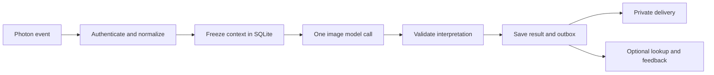

# How the sticker interpreter works

The backend turns an incoming sticker into a private explanation. The model interprets meaning; application code chooses context and recipients.

1. **Receive:** `src/adapters/photon.py` authenticates raw events through a supplied verifier, normalizes native fields, retrieves classified sticker media and sends text to verified private destinations. Real event decoding and native sticker classification depend on the Photon setup.
2. **Coordinate:** `src/main.jac` controls the workflow. Text updates history. A sticker creates one job per enrolled recipient. Assistant echoes and paused/unapproved conversations do not trigger interpretation.
3. **Freeze context:** `src/repository.jac`, `context.jac` and `store.jac` keep SQLite history and immutable requests. Each contains the target image/text, up to 25 preceding same-chat messages, character limits and declared preferences/relationship. There is no age cutoff. Later replies and saved feedback are excluded.
4. **Interpret once:** `src/adapters/vision.py` sends the actual image and permitted text to the model. `src/interpreter.jac` validates candidate output and applies policy: compatible meanings can both appear; opposing meanings produce one best guess with uncertainty; insufficient evidence produces an unsupported result. The assembly adapter composes this policy exactly once.
5. **Save before sending:** results and outbox entries are persisted before delivery. Job states record pending, interpreting, interpreted, sending and accepted work. Replays reuse existing jobs. Interrupted claims or unclear acknowledgments require reconciliation, since an automatic retry could duplicate a charge or message.
6. **Route outside the model:** enrollment determines recipients and private destinations. Groups require separate private threads. A verified direct source can reply in the same thread, with exactly the configured assistant and recipient. Message/model fields cannot grant this permission.
7. **Offer optional feedback:** `src/fetch_tools.jac` and `src/adapters/fetch_agent.py` retrieve saved explanations or record exchange-specific choices without reinterpreting the image. The public demo uses fictional records and process-local command deduplication. SQLiteStore supplies scoped persistent result/feedback operations for an injected trusted backend.

`src/context_store.py` is a thin object adapter over Jac database functions. `src/adapters/assembly.py` joins the different component APIs and translates send receipts. `src/demo.py` connects the real components to synthetic provider I/O and fixed model candidates. `python -m src demo` exercises real normalization, policy and durable storage without network calls. `python -m src mock-demo` preserves the earlier fully mocked harness.

## Why Jac is present

The project originally inherited global Codex commit/PR instructions and a repository rule requiring at least 40% Jac and preferring it for core logic. That rule caused workflow, validation, routing and storage policy to be written in `.jac` files. Python handles SDKs, object adapters and CLI code. `src/__init__.py` imports `jaclang`, registering the importer that lets the Python entry point load Jac modules.

**The user removed that quota and language preference on October 17.** No minimum percentage is enforced. Existing Jac modules remain to preserve working functionality; the application could use Python throughout after a deliberate migration. Neither Photon nor the model API requires Jac. Its pinned runtime and compilation checks remain technical dependencies while `.jac` source exists.

The old policy was removed from `~/.codex/config.toml` fields `desktop.git-commit-instructions` and `desktop.git-pr-instructions`, repository AGENTS guidance, active planning/templates and the source-share failure gate. Historical logs retain earlier checkpoints.

The offline checks establish compatibility, validation, routing and persistence with synthetic data. Fixed model candidates do not measure accuracy, and provider acceptance does not establish phone receipt. Live native sticker ingestion, real identity/destination verification and the complete phone demonstration remain separate evidence to collect.
